# A7 – FEA on Bracket

## Objective

The objective of this project is to perform Finite Element Analysis to improve the bracket design created from previous projects. Using the data from FEA, I will make geometric changes to improve the performance of the design, notably strength, stiffness, and weight. To inform these decisions, the analysis should include the correct constraints, loading, and meshing selection to ensure an accurate simulation is run. Using this simulation, I should identify maximum stress, displacement, and safety factors to help optimize my design. 

## Analyze

>Setup Before FEA

Before beginning to setup the FEA, I first began by defining what performance aspects I was looking for to determine my path to a successful design. These parameters were defined in previous projects, and included a yield strength of 40,000 psi (based on 6061-T6 aluminum used), a maximum deflection of no more than 0.005 inches, and a safety factor of 4. I kept each of these values in mind throughout this project to inform my optimizations. 

I then setup a table to keep track of these values as well as total mass and number of mesh elements for each of the three designs I will have by the end of the project. This will help compare my values after each iteration to ensure improvements are being made. 

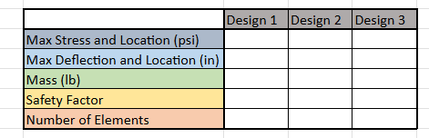

>FEA Constraints, Loadings, and Meshes

I am now ready to setup the FEA with the constraints, loading, and meshing. I first began by setting up the constraints. Based on the tolerances and spacing that would make room between the bracket the the T-beam, the only face guaranteed to make contact with the T-beam is the bottom end of the top portion of the top element of the bracket. I setup the fixture there as a roller, as this bracket would be able to slide across that face in the real world. 

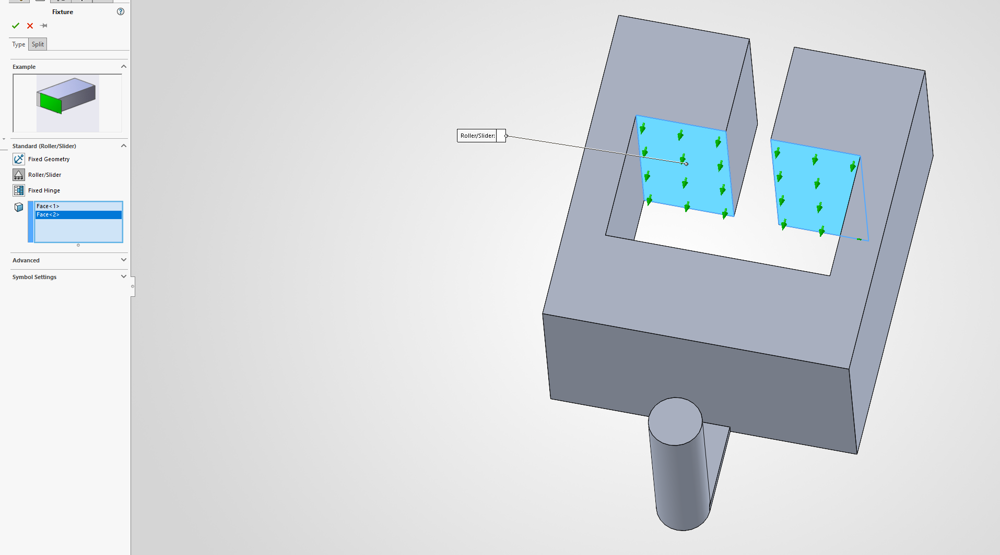

I then setup the loading of the bracket, which should only be the force on the cylinder that the strap wraps around. The strap pulls down on the cylinder while wrapped over the top of it, meaning that a bearing force is the best fit for this loading. To define a bearing force, I first made a coordinate system that I could base the force off of, setting the y-direction as the downward facing axis. I then created a bearing force that faced downward along the cylinder with a force of 1200lb, summing the two 600lb forces on either end of the strap.

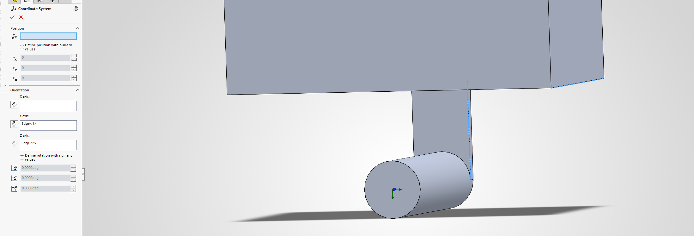
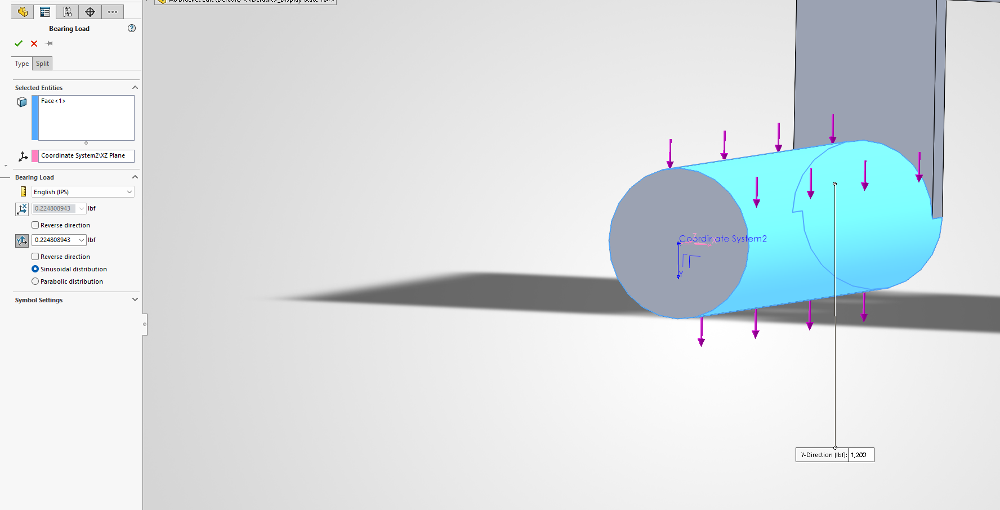

With this, I created my first mesh, using the default SolidWorks setting as my first mesh density. 

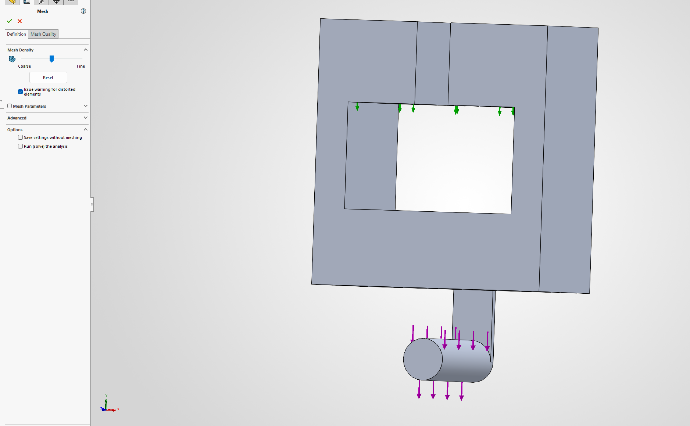
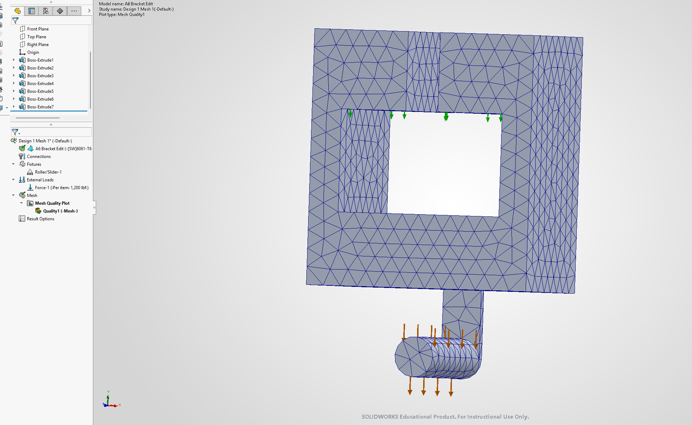

## Decide

>Running First Design

I believed I was ready to run my study, but ran into a unstable study warning. This meant that I was not fully constrained. To resolve this, I set two fixed geometry constraints on either side of the vertical face of the top of the bracket. This stops the bracket from sliding and rotating in ways that cause the study to be unstable. 

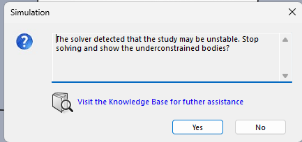
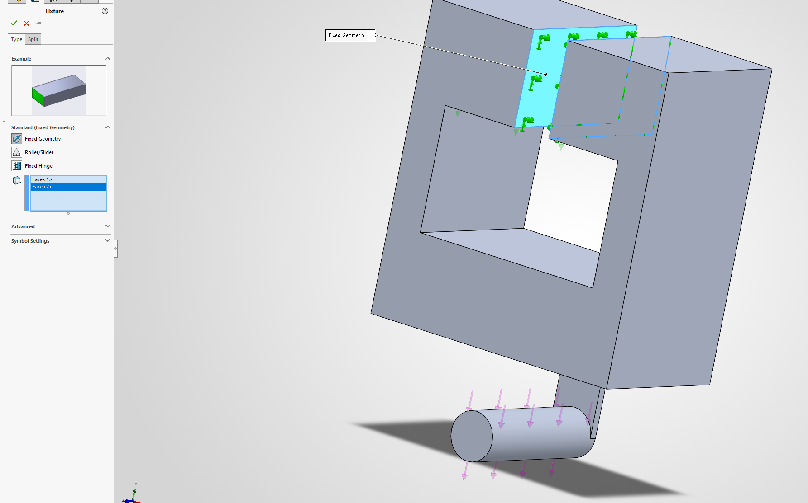

I then ran the study. Unfortunately, I was met with extremely high values for stress and deflection, meaning that either my constraints were not adequate or my design was improperly created. Using the unconstrained bodies tool, I found that my model was fully constrained, meaning that miscalculations had somehow led to a model that did not support the load it was required to. 

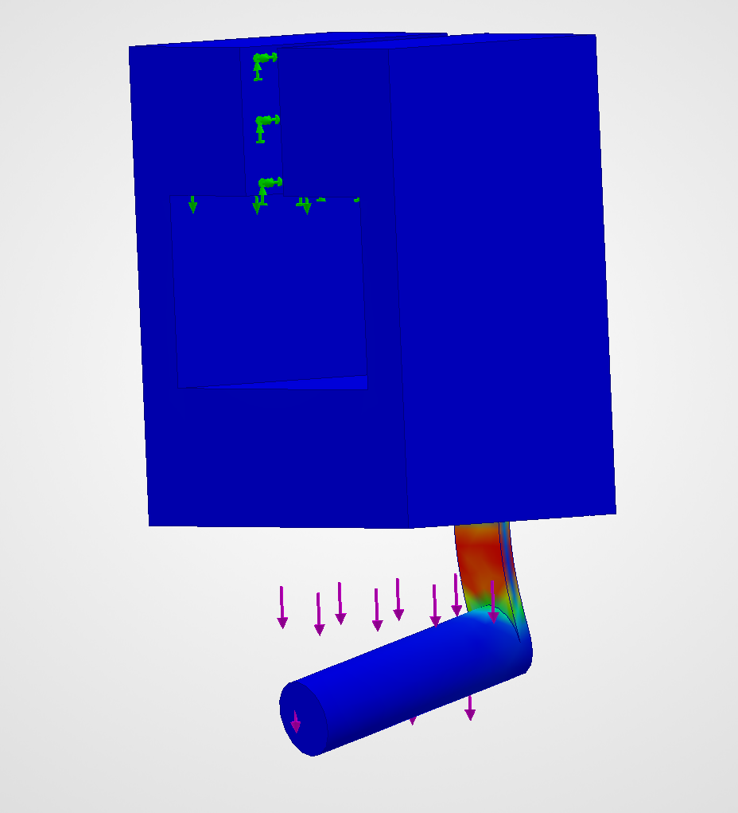
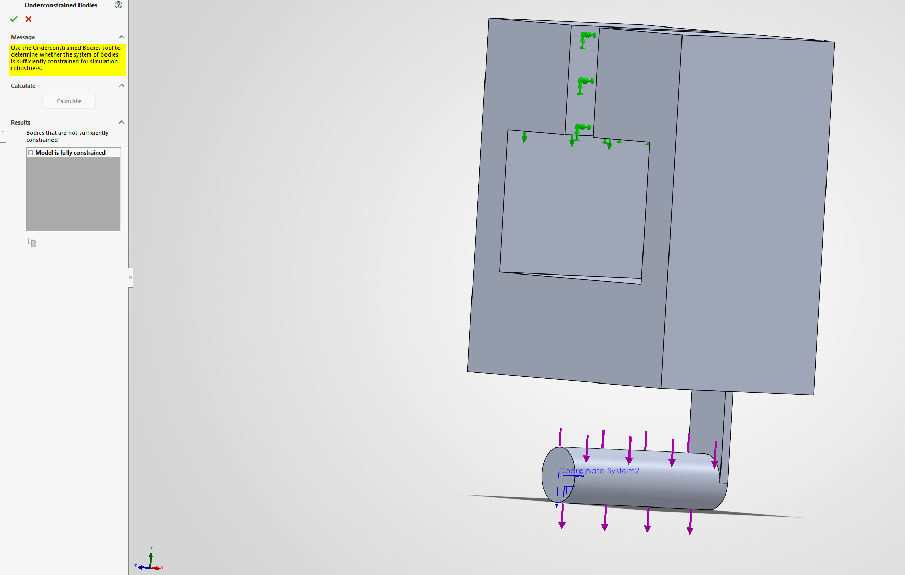

Despite, this I continued on with measuring each of the values, recording the max stress, max deflection, mass, minimum safety factor, and number of elements. To find the mass, I used the evaluate tool to pull up the mass properties of the model, recording the given model mass. To get the minimum safety factor, I created a new factor of safety plot, setting a maximum safety factor of 10 to more clearly see where issues are. 

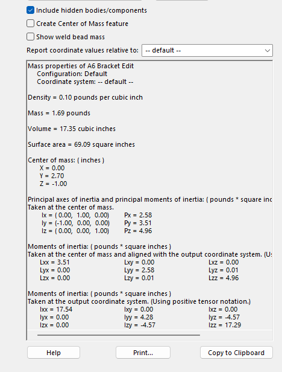
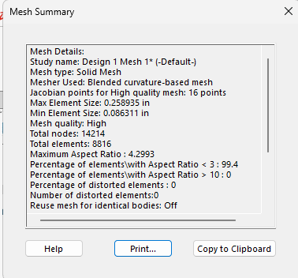
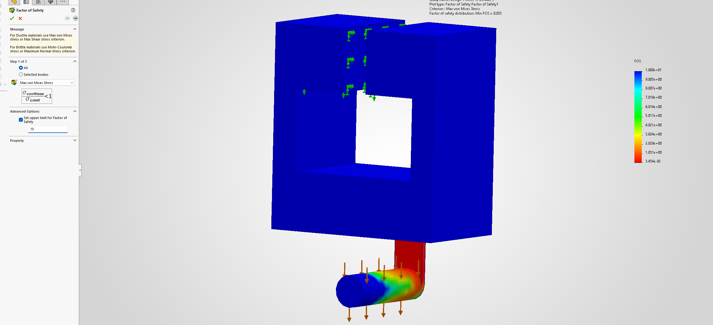

I then setup a new mesh with a finer density and reran the study, recording all of the same values. I then found the percentage difference between the stress, deflection, and safety factor values, finding that each of the fell below the convergence percentage of 7%. This meant that this design did not need a finer mesh to find the most accurate values. I recorded the final values I found from the study into my table. 

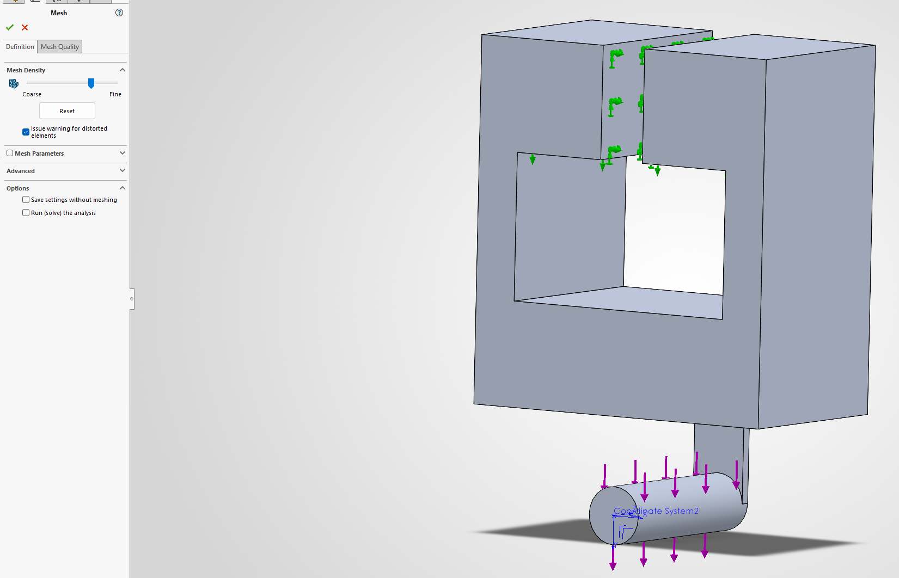

>Creating and Running Second Design

Based on the plots, the element which was creating the problems was element B, which connected the cylinder supporting the load to the body of the bracket. It was far too thin to support the bending forces it was receiving, leading to the high stress within it and high displacement of the cylinder's most forward face. To combat this, I increased the thickness of the element to 0.5 inches, reflecting it within both the model and equation tool. 

I then created a new study, beginning the default mesh and the same constraints and loadings as the previous study. After running the first study, I found that I had made big improvements in the max stress, max deflection, and minimum factor of safety, but not enough to warrant a successful design. THe increase in mass was minor, increasing by only 0.02 lbs. I reran the study with a finer mesh, leading to max stress and factor of safety values which failed to converge. They once again failed to converge for the third and finest mesh, which led to the end of this design's FEA. 

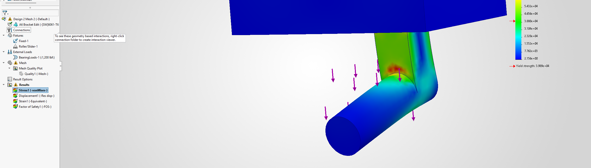

>Creating and Running Third Design

For the third design, I did not want to increase the thickness of element B further as it would take space that may cause the strap to be too thick to be fully supported by the cylinder. To continue to increase the strength of the element, I decided to add triangular ribs on either side of the element to increase its rigidity. Going back to the model, I created a sketch along the side of element B that formed a right triangle, supporting the element while not taking much more space that the strap should be supported by. I extruded it to be 0.1 inches thick and mirrored the same sketch and extrude on the other side. I then setup the constraints, loadings, and mesh to prepare the final FEA.

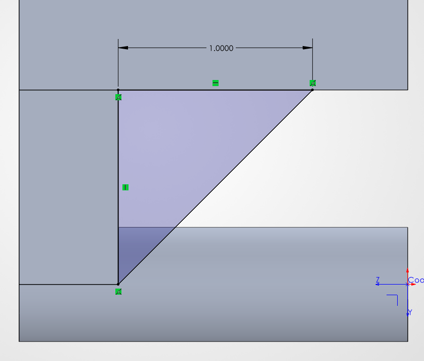
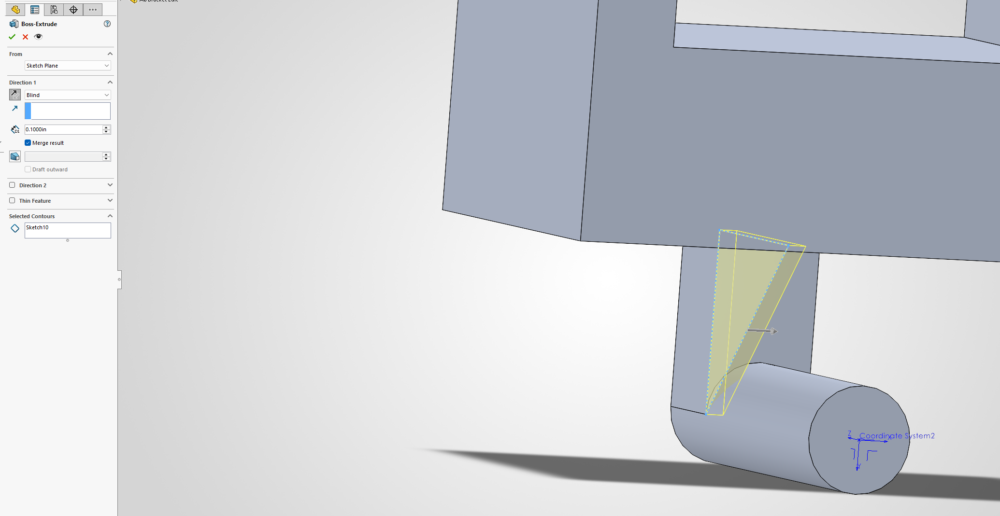
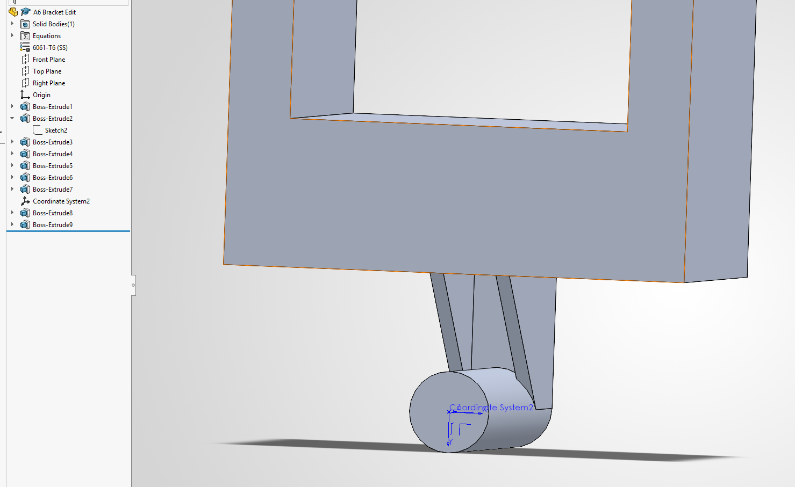
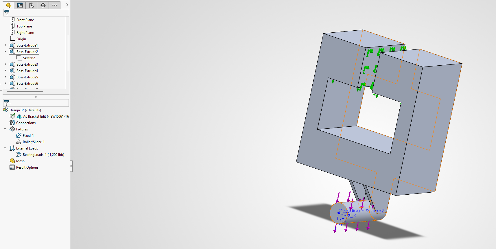
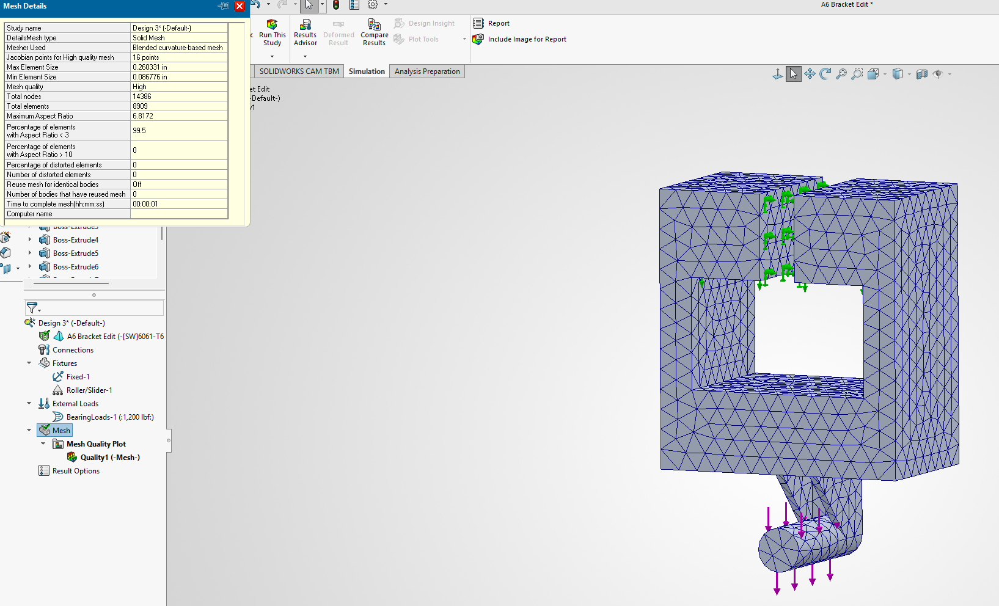

Running the first pass, I found some improvements in maximum deflection, but equal or worse values for maximum stress and safety factor. Inspecting the plots more closely showed me that this is likely because of the sharp corners created by the ribs, creating stress concentrations in these areas. Despite this, I continued forward, using a finer mesh that provided values for max stress and factor of safety that did not converge. This divergence remained for the third and finest mesh, marking the end of the study. 

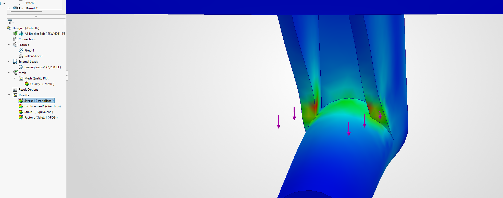

With all of the values acquired, I completed my table to show mostly stable improvements throughout each of my designs. 

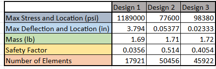

## Communicate
>Lessons Learned

This project taught me how to utilize data gained from FEA to create more optimized models that better achieve the defined goals of a design. Although my design was not reaching the goals I thought it would based on my calculations, I still was able to learn how to create geometric improvements that lessened the poor performance of my design. Beyond this, I also was able to gain more experience with setting up Finite Element Analysis, setting up constraints, loadings, and meshes. In particular, I learned new tools such as the unconstrained bodies tool and mesh convergence method to determine whether my analysis is providing accurate information. I also learned more ways to apply loads, such as using a bearing force.

If I had more time, my next step would have been to create a new design that used fillets to create a smoother transition between the ribs, element B, and cylinder to reduce the stress concentrations in that area. I also may have played with the geometry of the ribs provide element B with even more structure. 

In total, this project took me about 4 hours to complete. 

CAD Part can be downloaded here:

<a href="A6 Bracket Edit.SLDPRT" download>
  Optimized Bracket (.STL)
</a>

Note: The zip file with my FEA for each design is too large to include in Github. Please email me at bsalvi@charlotte.edu if these are needed. 
