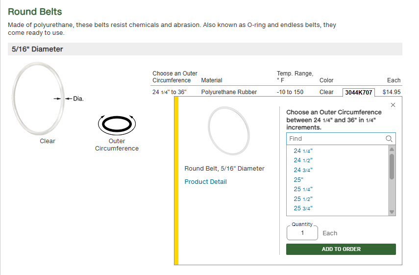
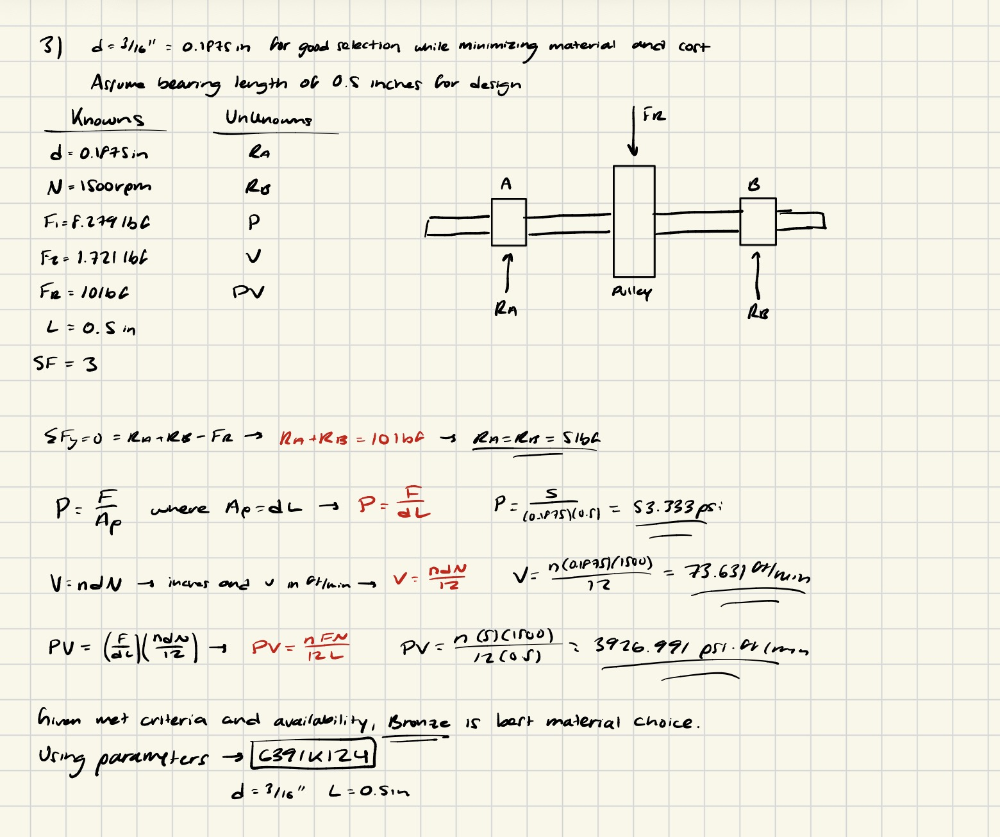
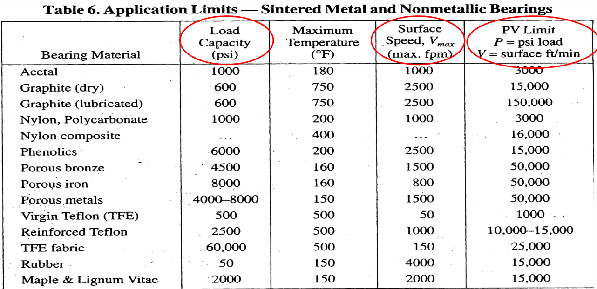
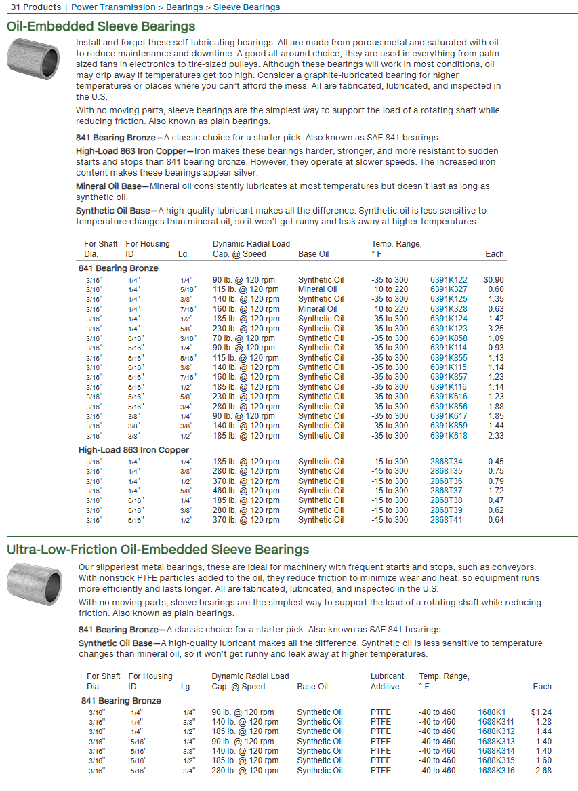
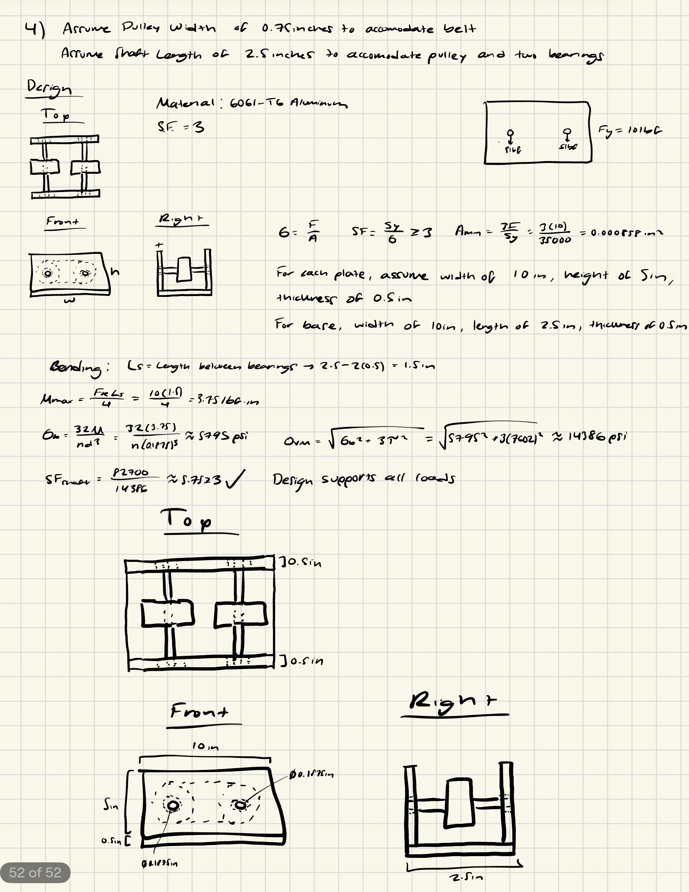

# A9 – Pulleys

## Objective

The objective of this project was to design and analyze a pulley system given specifications and geometric constraints. This project required the formulation of the proper equations necessary to fully define the geometry needed for the belt, shafts, and bearings, pairing these values with an equivalent real-world part. Once the parts were determined, they were utilized to design a support for the pulley system using engineering analysis to ensure rigidity. 

## Analyze

>Given Constraints

This project provided various constraints to the design of the pulley system that I would use to calculate the undefined areas of the system. The design was a belt between two parallel pulleys that have a center distance of 4-6 inches. The pulleys have a diameter of 3 inches each, with an operating speed of 1000-2000 rpm. The belt tension under stationary conditions needed to be between 4-6 lbf, with pulleys made of aluminum, ABS, or steel and a polyurethane rubber belt. A safety factor of 3 was given. 

Before proceeding with the calculations, I decided to set the center distance to 5 inches, operating speed to 1500 rpm, and tension to 5 lbf. I also choose aluminum for the material of the pulleys. The calculations would also require a coefficient of static friction to determine the belt geometry. Using a table which provided coefficients for various polyurethane and aluminum combinations, I decided to set the coefficient of friction to 0.5 for my calculations, which sat around the middle of the range. 

## Decide

>Belt Design

I was now ready to determine the geometry of the belt. I began by setting my unknowns and knowns and drawing a free body diagram of the forces on the belt. Using the free body diagram, I created a statics equation and used it paired with a force-friction equation to find the two separate forces for the tight and loose end of the belt. Using these forces, I found the maximum transmitted torque and minimum cross-sectional area of the belt. I used this to determine the minimum diameter of the belt at 0.2591 inches. Using the McMaster page, I found the closest size above this minimum diameter, which was 5/16ths of an inch. I then used this value to calculate the outer circumference of the belt to fully define its geometry, finding it to be 21.39 inches. 

However, the McMaster page had no belts that fit both of these dimensions, meaning that I had to find a new diameter and circumference. I decided to increase the diameter to 3/8ths of an inch and recalculated the circumference, which became 21.78 inches. With this being within the range of products found in the McMaster page, I ended up picking the 3044K608 belt with a diameter of 3/8ths of an inch and a circumference of 21 inches. This slightly smaller circumference than the one calculated will allow the belt to stretch and grip firmly on the pulley surface, ensuring no slip. 

>Shaft Design

It was now time to design the shaft. Given a set material of AISI 1060 hardened steel, I found the yield strength to be about 82,700 psi. Similarly to the belt calculations, I set my knowns and unknowns and drew a free-body diagram, using it with a static moment equation to find the transmitted torque to equal the previously calculated value of 9.837 lbf-in. Using shear equations, I determined the symbolic representations of max and allowable shear stress, which I substituted into the minimum diameter and area equations for the shaft. Plugging in my values, I found the minimum diameter needed to be 0.154 inches. 

>Bearing Design

With the shaft and belt fully defined, I could now design the journal bearings. To begin, I set the shaft diameter to be 3/16ths of an inch, above the minimum diameter value calculated before and at a diameter that had a large amount of availability and minimal extra material. I also assumed a bearing length of 0.5 inches to make the calculations possible. Using these values and my newly listed unknowns and knowns, I drew another free-body diagram and created a static equation to solve for the forces of each bearing supporting both ends of the shaft, with each being equal to 5 lbf. Using this value and my other given values, I found the pressure, velocity, and PV values that I then compared to the table provided in the Machinery's Handbook to determine the best bearing material. I chose bronze, as it met the criteria for each value while also being highly available as a bearing material. 

Given these parameters, I chose bearing model 6391K124, as it had the geometric values and bronze material needed for my journal bearings. 

>Frame Design

To conclude the project, I designed a frame in order to support the pulley system. To create it, I assumed a pulley thickness of 0.75 inches in order to properly accommodate the belt. I also assumed a shaft length of 2.5 inches to comfortably hold the pulley and journal bearings on either end of the shaft. I chose a material of 6061-T6 aluminum to keep the design light and continued my use of a safety factor of 3. My preliminary design without dimensions included parallel plates on either side of the two shafts to support all 4 journal bearings with a base connecting the two vertical plates together. 

To find the minimum area of each plate, I used the tensile stress equation, finding a vary small minimum area. This meant that I did not need to worry about the plate being too small, allowing me to keep the dimensions of it tight but large enough to encompass the necessary components. To fully protect the pulleys, I set the width to 10 inches and height to 5 inches, with a thickness of 0.5 inches to accommodate the bearings. For the base, I matched the width and thickness with the plates for uniformity and ease of manufacturing with a length of 2.5 inches to perfectly place the plates to support the shafts. To confirm the design's safety, I then using bending equations to make sure that the bending stress on the shafts was within my factor of safety. Finding a factor of safety of nearly 6, the design was finalized. 

## Communicate

