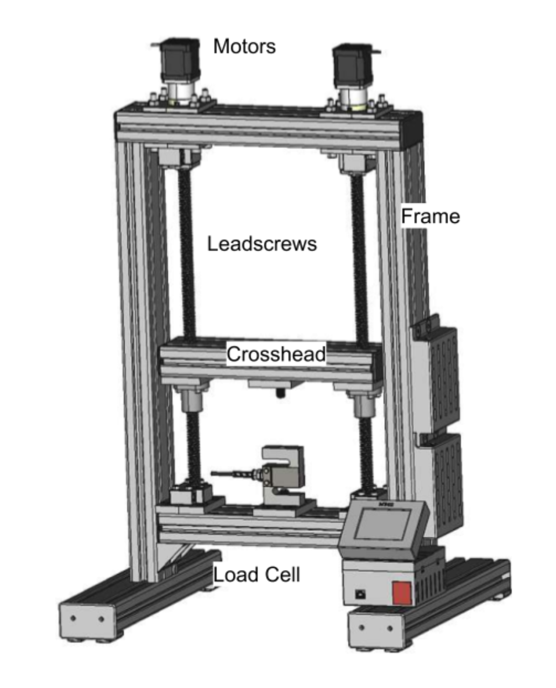
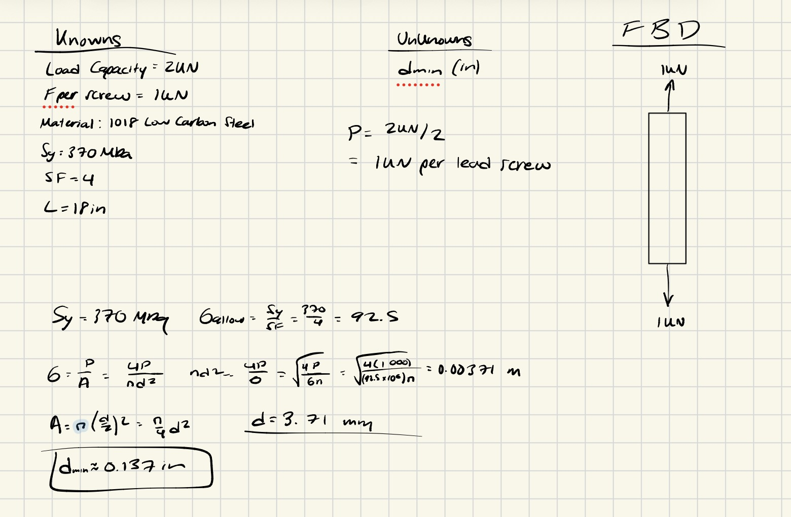
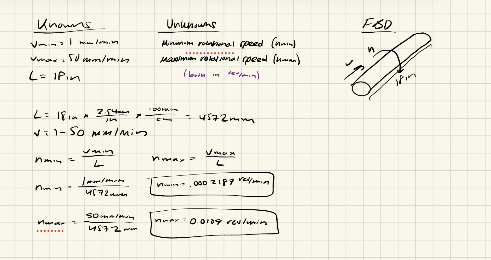
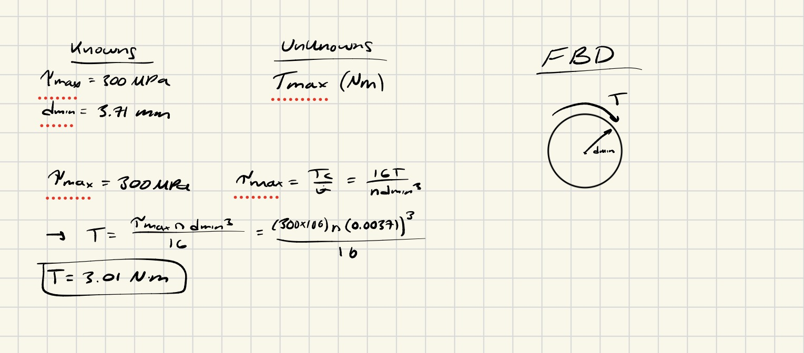
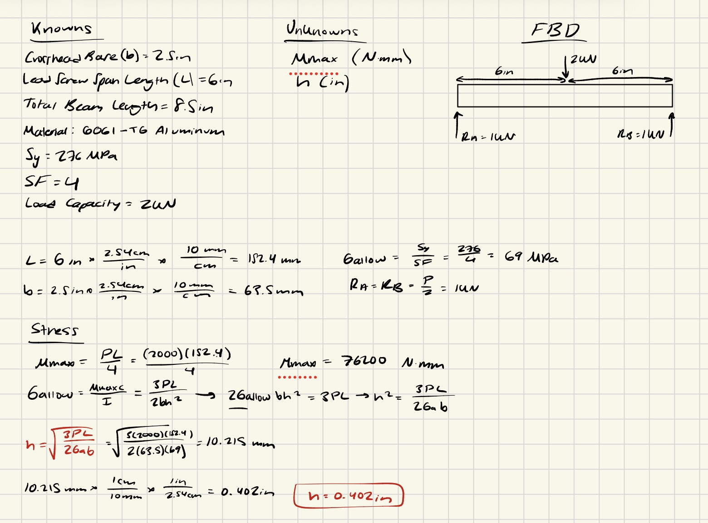
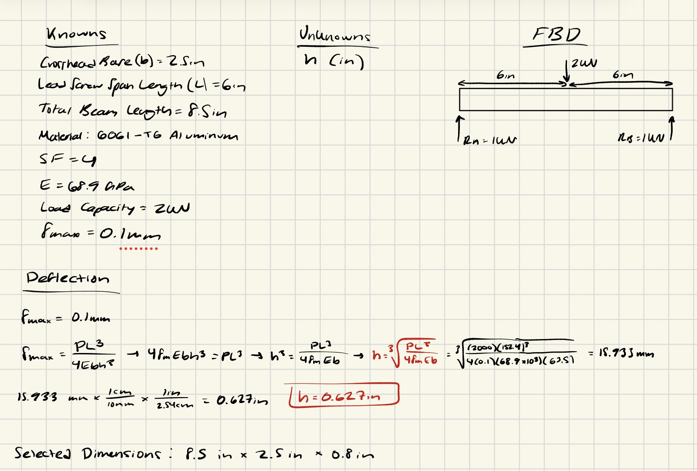
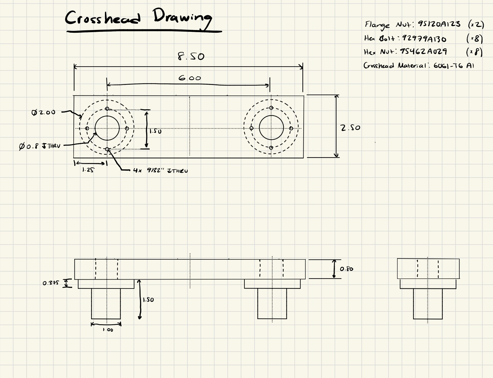

# A10 – Lead Screw Translating System

## Objective

The objective of this project was to design a Tensile tester with a leadscrew system with a group of team members. This included designing the various components, including the leadscrews, crosshead, nut flanges, and frame. In the next project, the motor systems will also be added. This project provided practice in designing based off of given restraints, utilizing the values from one component to determine the needed properties of another component. It also required us to pick real world parts that best matched our needs for the leadscrew, flange nut, and frame. 

## Analyze

>Given Constraints

In this project, we were given a concept of a Tensile Tester we were able to use to understand the design of the machine. The design includes two lead screws connected via a crosshead, with two motors driving the two lead screws. The crosshead was supported by nut flanges, with the entire system surrounded by a box-like frame. 

As for the key constraints, an axial load capacity of 2 kN for the system is provided, not just for each leadscrew. Also, a speed range of 1-50 mm/min was given with a minimum leadscrew length of 18 inches. Finally, a safety factor of 4 was provided. 

In our case, we decided to go with the minimum leadscrew length of 18 inches due to the availability of sizes found on McMaster. We also chose 1018 Low Carbon Steel as the leadscrew material for our preliminary calculations, with a yield strength of 370 MPa and shear strength of 300 MPa.

## Decide

> Combined: Leadscrew Calculations

To determine the needed geometry and strength of the leadscrew, we began by finding the minimum diameter needed. Using axial stress, we determined that the axial stress on each leadscrew was half of the axial load capacity, making it 1 kN for each leadscrew. Using the shear strength, safety factor, and load, we determined a minimum diameter of 0.137 inches for each leadscrew.

We then determined the range of rotational speed given the linear speed of 1-50 mm/min. by dividing the minimum and maximum linear speed by the length of the leadscrew, we found a minimum rotational speed of 0.0002187 rev/min and a maximum rotational speed of 0.0109 rev/min. 

Finally, we determined the max torque needed to provide the 2 kN tension to the test sample.  Using shear strength and calculated minimum diameter, we found a max torque of 3.01 Nm.  

Based on these values, we pinpointed leadscrew model 93255A233 on McMaster as the ideal choice, meeting the length of 18 inches with a diameter of 0.75 inches, which is well above the minimum needed for safe use. It also is made of 1018 Low Carbon Steel, which was the material assumed in our calculations.

> Bruno Salvi: Crosshead Calculations

Utilizing the previous flange calculations, it was time to calculate the crosshead dimensions. Using a flange diameter of 2 inches, I set the base dimension to 2.5 inches to allow the flange to sit flush on the crosshead without any material hanging off. I then set the lead screw span length to 6 inches to fully define the geometry to find the crosshead thickness needed. Finally, I decided to make my crosshead out of 6061-T6 aluminum to keep the design lightweight. 

Using these values and a safety factor of 4, I drew a free body diagram, finding the support forces to be 1 kN each to support the 2 kN load capacity. To find the needed thickness, I first used stress as the driving variable, finding a thickness of 0.402 inches. 

I then used deflection, with a max deflection of 0.1 mm. This parameter yielded a thickness of 0.627 inches. Since the deflection thickness was higher, it marked the minimum thickness needed for a strong enough design. To make the crosshead easier to manufacture, I set the thickness to 0.8 inches, leading to the final dimensions of 8.5in x 2.5in x 0.8in.

To fully define the crosshead, I then drew multiview drawing with the given dimensions, with a front, top, and right view. I also included the flange nuts being utilized, with a 4-screw mounting solution for each nut. This ensures that they will stay secured onto the crosshead for full functionality of the tensile tester. To ensure the mounting solution is defined, I also located parts to mount the flange nut, with hex bolts and hex nuts being provided. 

## Communicate

