# A11 – Motor Selection

## Objective

The objective of this assignment is to design a motorized drive and frame for a 2 kN tensile tester. Through calculations and design work, a motor needs to be selected, confirm frame integrity, and mounting design for the motor. These design decisions will allow the smooth translation of the crosshead under a safe torque and speed for tensile tester of a high load. Pictured below are the given constraints and values for this assignment.

## Analyze

>Combined: Motor Selection

For the motor selection, we used values for one half of the needed 2000 N load to find what each motor needed to provide. A 30% efficiency value was used to find a torque value that will not be overused but can still provide the needed torque to translate the crosshead vertically. With these values found, a torque of 2.695 Nm was required or 381.64 in-ozf. A RPM range of 0.197 to 9.84 was calculated to find a motor. From the McMaster website, NEMA 23 6627T923, square body motor was selected. The maximum holding torque is valued at 467.3 in-ozf and a maximum rotation speed of 300 RPM. This motor provided sufficient torque as well as RPM range for our needed values.

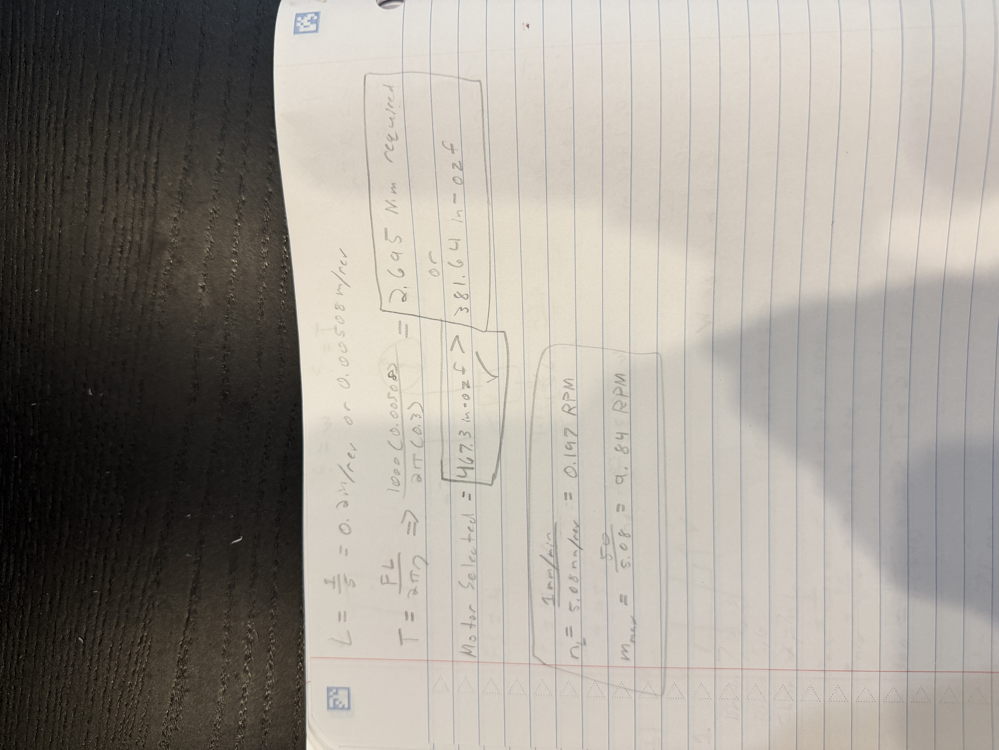


## Decide

>Jason Key: Motor Bracket Design

After selecting the motor, the next step was to design a bracket that will secure the motor to the frame to ensure the leadscrew to be turned properly. First, the knowns and unknowns were listed then a Free Body Diagram was drawn to further find the needed thickness value to hold the force and torque of the motor. After calculations, the thickness needed to be a minimum of 0.0717 mm. With this in mind, a thickness of the bracket was selected to be 6 mm to hold the motor well with the power required without any issues of mounting.

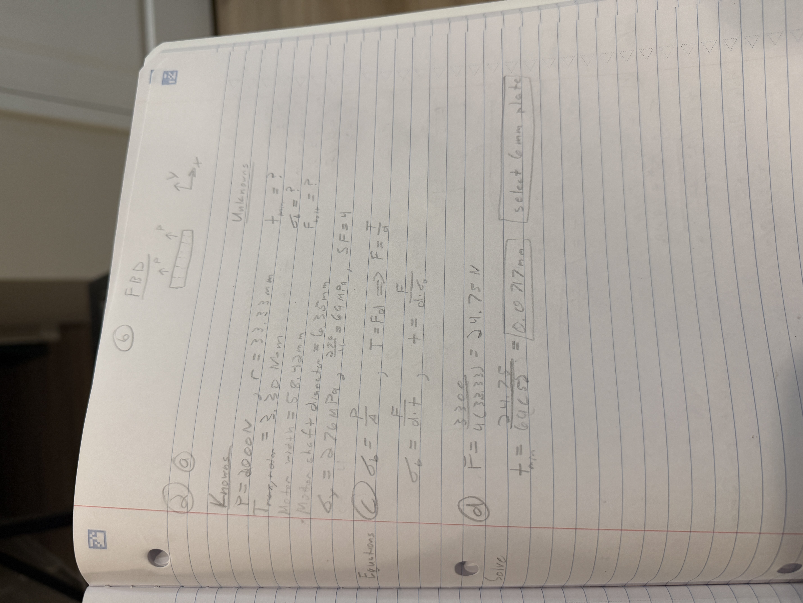

Then, a SolidWorks model was created to create a design for our 3D modelled assembly.

>Brandon Cogill: Coupler Design

For the Coupler, we selected a flexible shaft coupler to connect the motor shafts to the lead screws. We used the coupler specifications to find the maximum torque it could handle and used torsional stress equations to calculate the minimum wall thickness needed. We also checked the selected coupler's dimensions against the calculated thickness to make sure it could handle the twisting force.

>Brandon Cogill: Twist Analysis

The Twist Analysis, we looked at the twisting forces created by the two motors and how those forces affect the top of the frame. We calculated the total reaction torque from both motors and used it to determine the forces acting on the frame connections. We also looked at different T-slot brackets, bolts, and connectors that could be used to attach the top horizontal frame to the vertical supports while keeping the frame stable during operation.

>Bruno Salvi: Top Frame FEA

To ensure the top portion of the frame created in the previous portion of the project is able to support the loads of the motor and leadscrew, an FEA analysis was required. Taking the SolidWorks model of the top of the frame, I utilized the split line tool to allow the area where the bracket would sit to be the region where the forces were distributed. This ensured an accurate simulation by making the setup as realistic as possible.

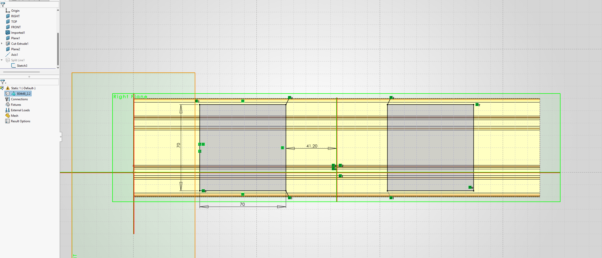

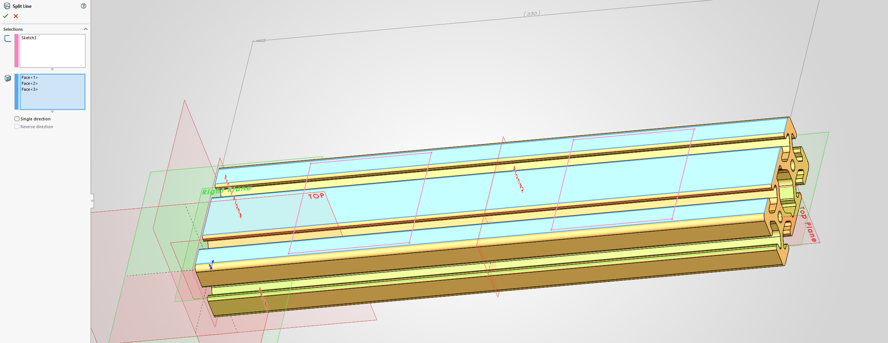

I then applied the force of both lead screws on each region, setting each region to 1 kN. The direction was set downwards to represent the axial tension being transferred to the frame. I then applied the two separate 3.3 N*m torques in each region. Finally, I applied fixed geometry constraints to both ends of the frame to represent the top frame being mounted between both sides frame pieces. 

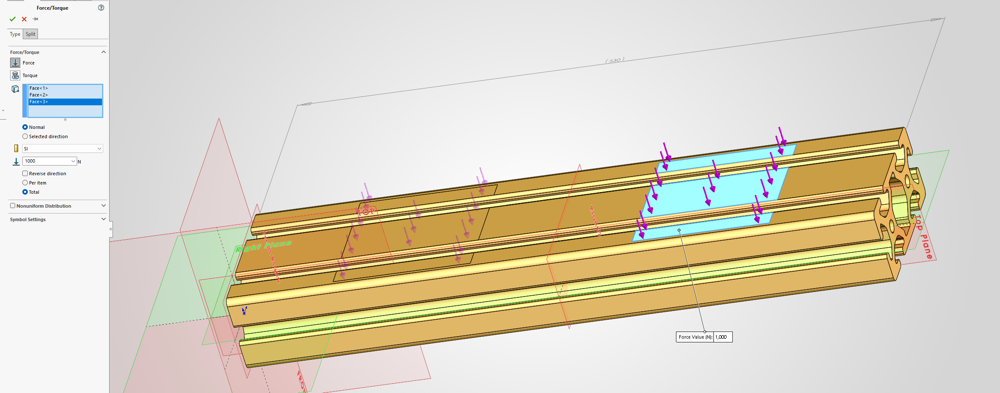

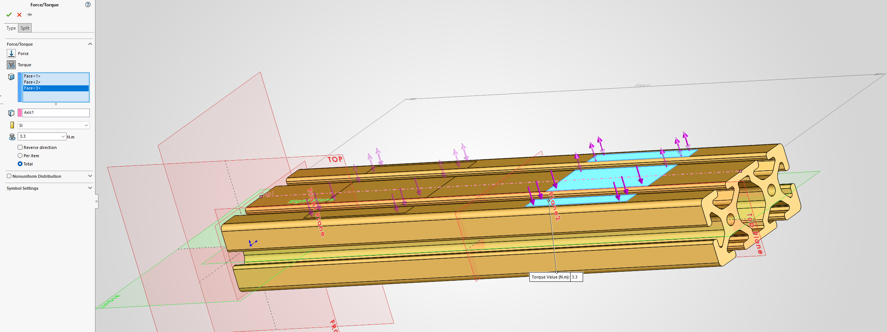

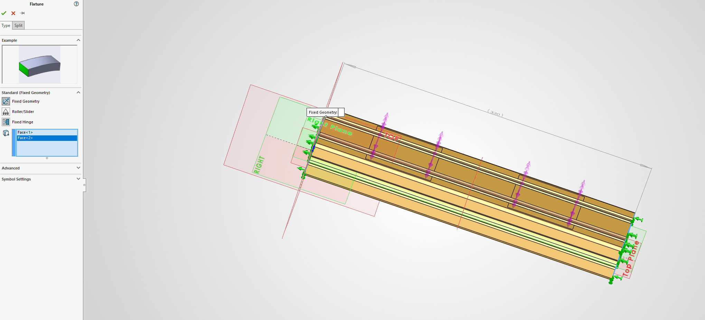

I then ran the study with a coarse mesh, noting the maximum Von Mises stress, maximum displacement, and minimum factor of safety values. To ensure convergence, I ran two more iterations with increasingly finer mesh, marking the values of each. To ensure convergence, I found the percent difference of each value between iterations, ensuring that they remained within 7% for acceptable convergence. 

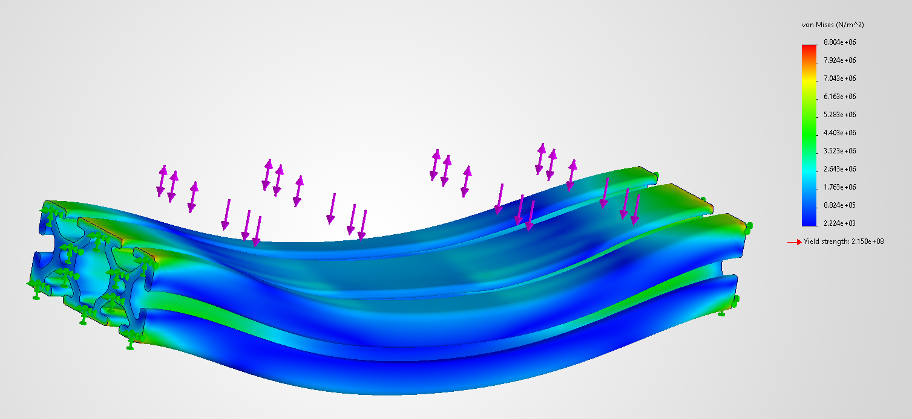

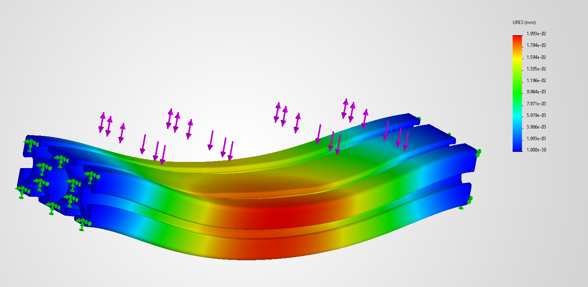

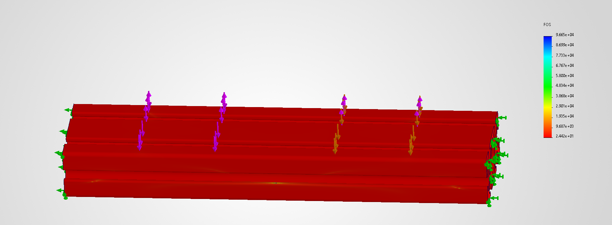

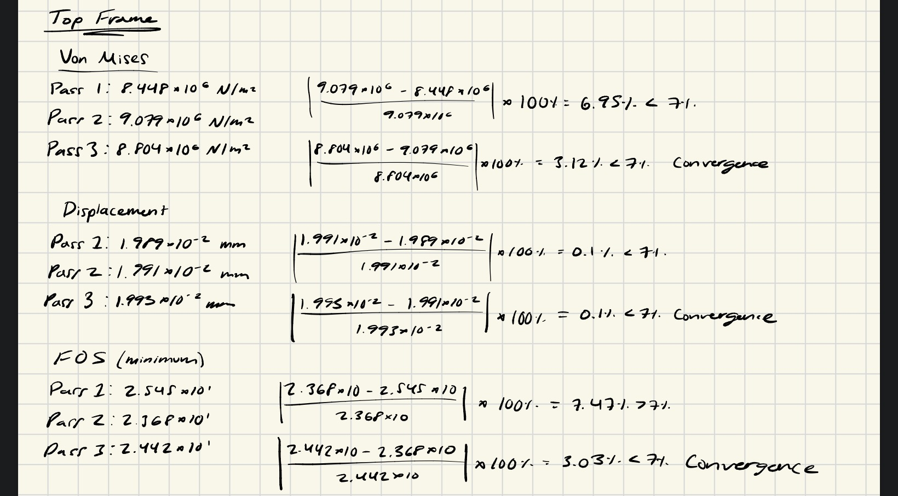

The maximum Von Mises stress was 8.804*10^6 N/m^2, which was far below the yield stress of the 6063-T6 aluminum the frame is made of. The displacement was under 0.01993 mm, which is acceptable given the load. Finally, the factor of safety remained well over the benchmark of 4, sitting at 24.42.

Although the design is more than strong enough to withstand the loads and torque being applied, some changes could be made to ensure consistent performance. Increasing fillet size will ensure that no stress concentrations are created in the frame. Furthermore, pocketing into the side frames can ensure that the top frame is well supported at both ends by supporting the bottom of the ends of the top frame. This will improve the performance even further. The critical location is in the middle of the beam, where it is furthest from the supports. It remains there with these changes as the load and torque remains the same. 

>Bruno Salvi: Side Frame FEA

It was now time to analyze the side frame to ensure it is strong enough. The side frame's region where loads where applied is simply at the top of the frame, meaning the split line tool is not required. Since I was only focusing on one side frame, I applied the force of one leadscrew downwards onto the top of the frame, set to 1 kN. I created an axis down the center of the side frame to reference the torque applied by the motors, setting to 3.3 N*m around the axis. Finally, I applied a fixed geometry constraint at the base of the side frame to act as the support of the ground. 

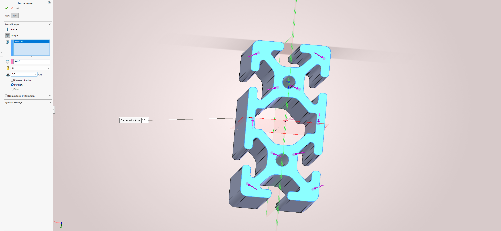

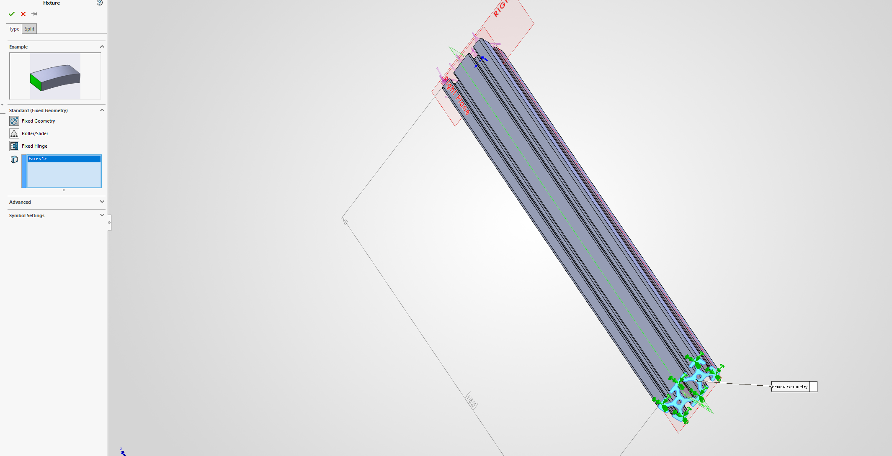

I then ran the study using the same iterative method, applying a coarse mesh and noting the values. I ran the next two iterations with finer meshes and used percent difference to ensure convergence. The maximum Von Mises stress was 1.933*10^6 N/m^2 which is even lower than the top frame. The maximum displacement is 0.03271 mm, which is acceptable, and the minimum factor of safety is 111.2, which is extremely high. 

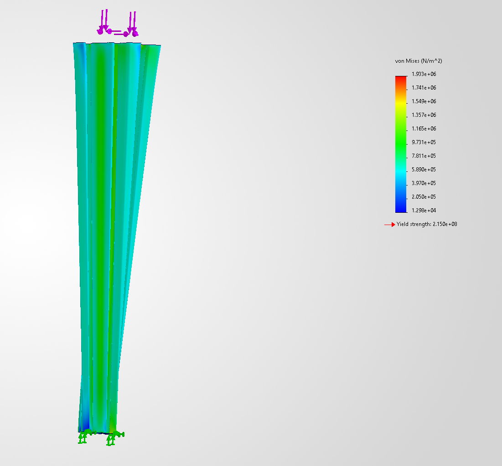

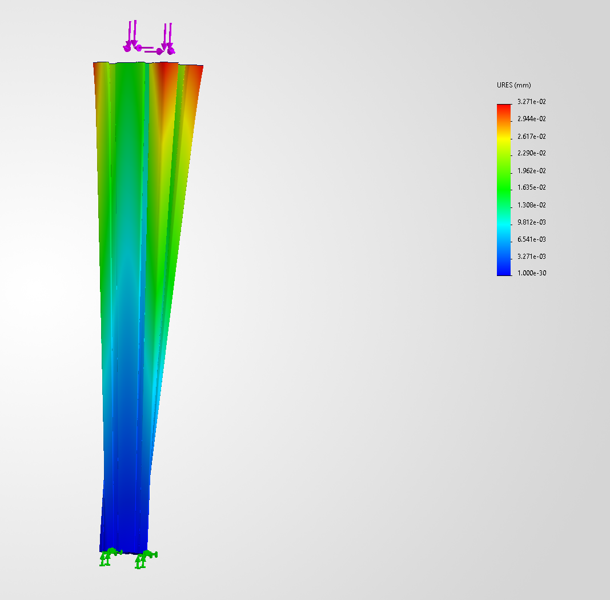

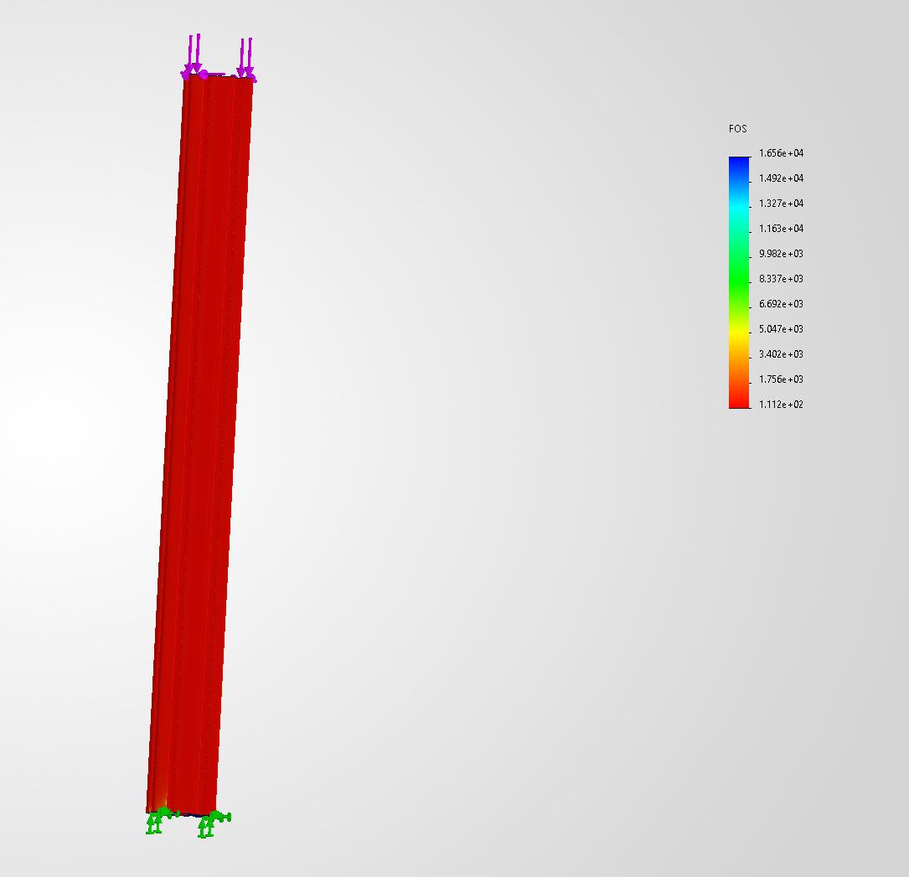

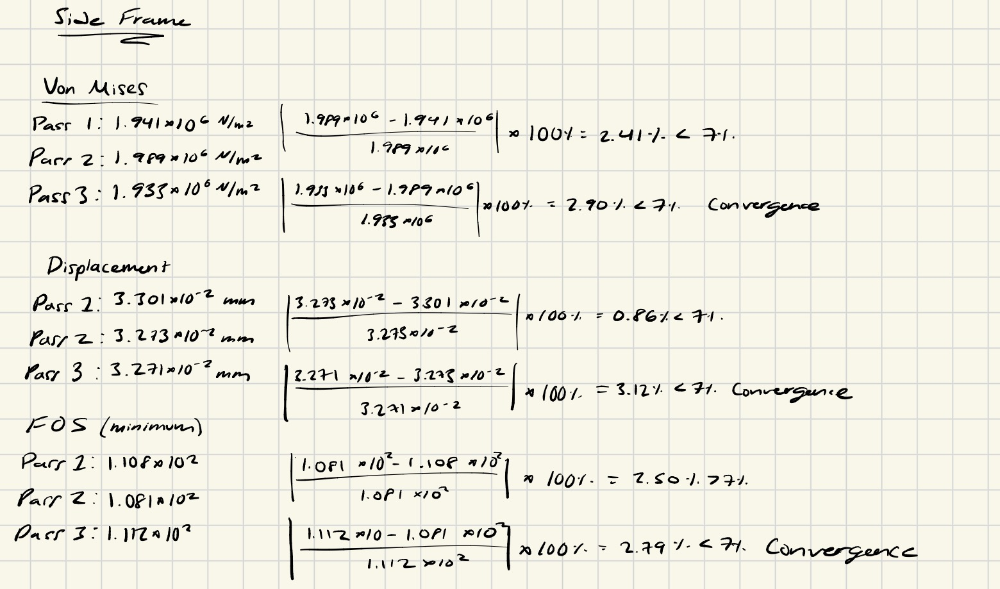

This design is very sound, but improvements could be made to it to minimize the twisting occurring. Ribbing could be incorporated into the beam to strengthen the beam against the twisting torque forces. This would be applied along the length of the beam as it is twisting laterally. The critical location would not change, as the most stress and displacement would still occur at the top of the beam where it is furthest from the fixed geometry.

Although the design is more than strong enough to withstand the loads and torque being applied, some changes could be made to ensure consistent performance. Increasing fillet size will ensure that no stress concentrations are created in the frame. Furthermore, pocketing into the side frames can ensure that the top frame is well supported at both ends by supporting the bottom of the ends of the top frame. This will improve the performance even further. Even with these changes, the critical locations will remain as the mounting point of the motor bracket where the forces are stemming from.  

CAD Parts can be downloaded here. Note that I did not include the simulation data as the file size would be too large.

Top Frame: 
<a href="Top Frame.zip" download>
  Top Frame
</a>

Side Frame:
<a href="Side Frame.zip" download>
  Side Frame
</a>

>Jason Key: Journal Bearing Mount

Finally, a journal bearing mount is needed to connect the bottom of the leadscrews to the frame. Using the RC 3 fit table 8a in the Machinery's Handbook on page 654, I found the needed tolerance of the diameter to be +0.0005 / -0.0000 inches. Using a Free Body Diagram, a thickness minimum was found to be 1.65 mm but to be safe, I selected a value of 12 mm. A vertically standing mount was chosen with a nominal inner diameter of 19.05 mm and an outer diameter of 40 mm. Then, I modeled the mounting design in SolidWorks.

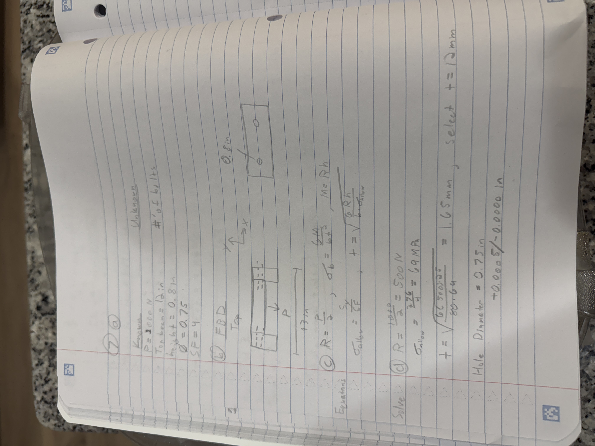

>Brandon Cogill: Bill of Materials and Labor Costs

| Item Number | Quantity | Name | Cost/Item | Cost | Purchase Link |
| :---: | :---: | :---: | :---: | :---: | :--- |
| 1 | 2 | Stepper Motor | $308.46 | $616.92 | https://www.mcmaster.com/6627T923/ |
| 2 | 2 | Couplers | $413.44 | $826.88 | https://www.mcmaster.com/6259K37/ |
| 3 | 2 | Lead Screw | $35.49 | $70.98 | https://www.mcmaster.com/93255A233/ |
| 4 | 2 | Nut/Flange | $160.09 | $320.18 | https://www.mcmaster.com/95120A123/ |
| 5 | 1 | T-Slot Framing | $245.87 | $245.87 | https://grainger.com |
| | | | **Total Cost** | **$2,080.83** | |

| Person | Hours worked | cost/ hour | cost |
| :---: | :---: | :---: | :---: |
| Bruno | 10 | 35 | 350 |
| Brandon | 8 | 35 | 280 |
| Jason | 10 | 35 | 350 |
| | | **Total Cost** | **980** |

**Total Cost of Project:** **$3,060.83**

## Communicate

>Lessons Learned

This project taught us how to apply analysis to motors, using calculations to select the best motor for our design and integrating it into the frame. This practice allows us to better understand how to incorporate components into a fully assembled design by accounting for the extra loads and support they bring in. We also gained more practice in selecting components that can be purchased based on our calculated requirements, which we did by selecting a motor that would best fit our tensile tester design. 

For each of us, this part of the project took about 4 hours to complete. 
